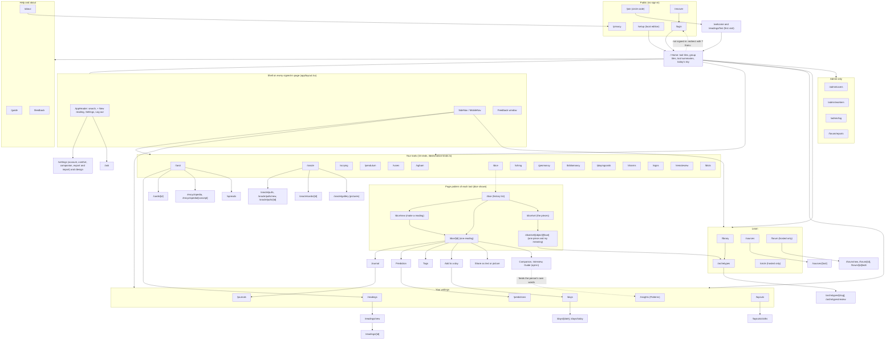
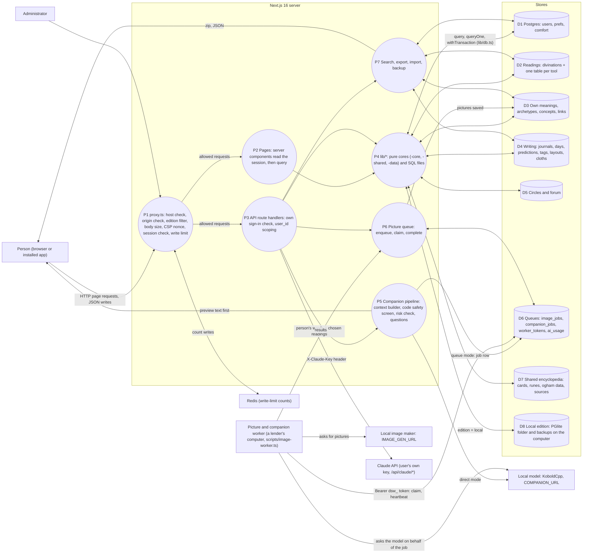
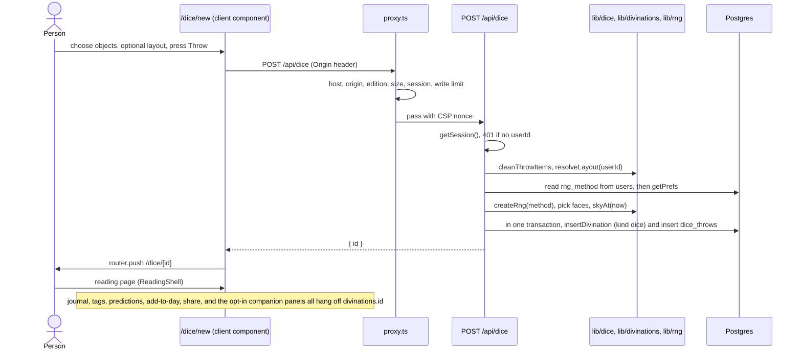
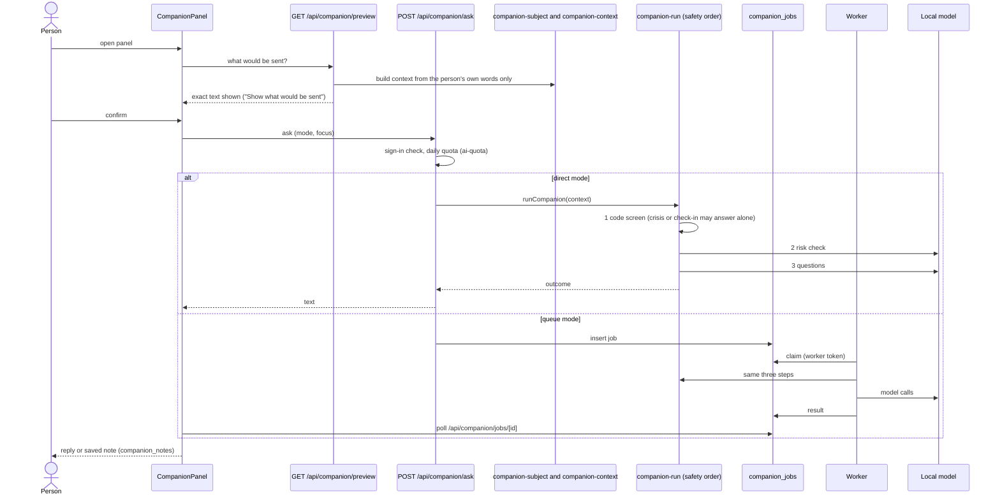
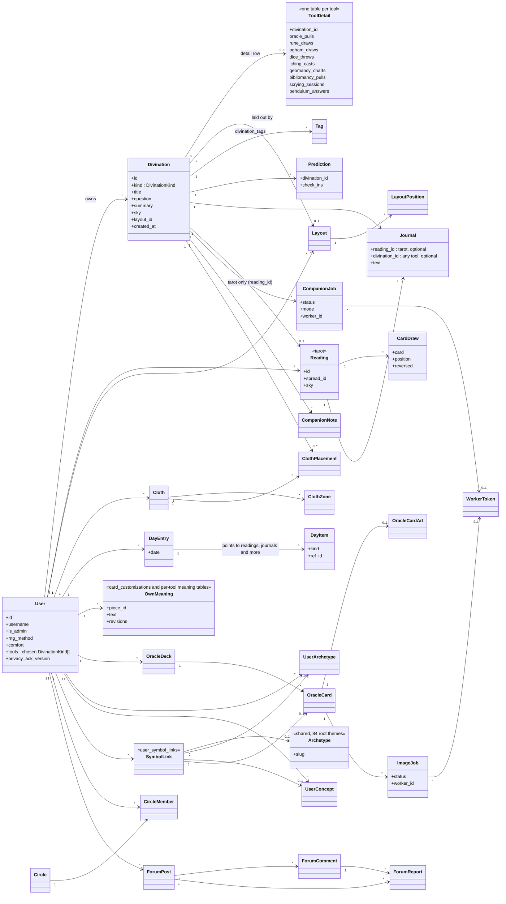
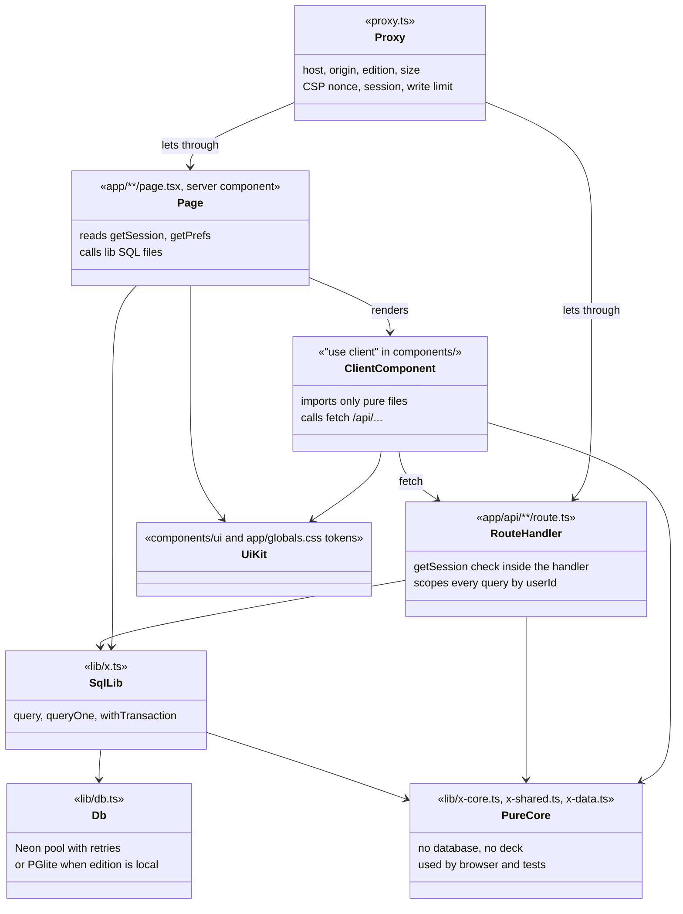

# App diagrams

Drawn on 2026-10-20 from the code at commit 6d5f0ce. Mermaid diagrams: GitHub and most editors draw them. `docs/app-map.md` is the written map; where this file and the code disagree, the code wins.

What was read: `lib/nav-groups.ts`, `lib/divination-kinds.ts`, `proxy.ts`, `app/layout.tsx`, `app/page.tsx`, `lib/db.ts`, `lib/edition.ts`, `components/tools/ReadingShell.tsx`, `app/api/dice/route.ts`, the `lib/companion-*` file names and imports, the folder listings of `app/` and `app/api/`, and the foreign keys in `migrations/`. What was not read line by line: most API routes, forum and circle internals, the picture worker script. Those parts are drawn from file names and imports.

## 1. How the pages connect

Every page sits behind the sign-in check in `proxy.ts`, except the public ones (`/login`, `/join`, `/recover`, `/setup`, `/privacy`). The side navigation and the home tiles are drawn from the same list (`NAV_GROUPS`).

## 2. Data flow diagram

Level 1. Circles are processes, open boxes are data stores, rectangles are things outside the app. Nothing reaches the AI companion without the "Show what would be sent" step.

## 3. One request, end to end: throwing dice

This is the pattern every tool follows (`app/api/dice/route.ts`).

## 4. The companion, from words to answer

## 5. Class diagram (UML): the data model

Tables drawn as classes, foreign keys as associations. Each tool's own table links one to one to `divinations` (a shared header row with kind, title, question, summary, sky), which is why journals, tags, predictions and the companion work the same for every tool. Tarot is the older design: `readings` and `card_draws` came first, and since migration 023 each reading also has a `divinations` row (through `divinations.reading_id`) so it appears in the shared lists. A journal entry points at a tarot `reading_id` or at any `divination_id` (migration 022).

## 6. Class diagram (UML): the code layers

How a feature is split so that nothing server-only reaches the browser (`before-you-code`, section 4).

## Drift found while drawing (for `open-item-sync`)

- `docs/app-map.md` has no rows for charm casting, signs and dreams, playing cards, blind-target practice or tea leaves and ink, although `lib/divination-kinds.ts` lists them as tools and each has pages.
- Tarot is the one tool whose detail lives in older tables (`readings`, `card_draws`) joined to `divinations` by `reading_id`; every other tool has a detail table keyed by `divination_id`. Not a fault, but the one place where the pattern splits.
